<!-- Hero Banner -->

 

<!-- Three Linked Action Tiles (32.5% each) -->

  

<!-- Developer Profile Terminal ($ whoami, certifications, tech stack) -->

 

<!-- GitHub Signal Metrics & Language Telemetries -->

 

<!-- Monthly Contribution Activity Pulse -->

 

<!-- Featured Repositories - Row 1 -->

 

<!-- Featured Repositories - Row 2 -->

  

<!-- 53-Week Contribution Trail Heatmap -->

 

<!-- System Status Footer -->

